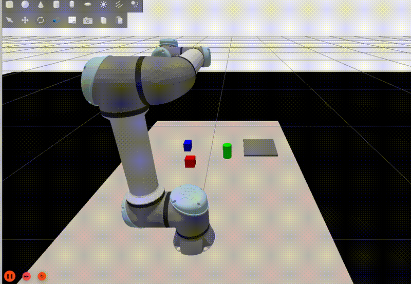
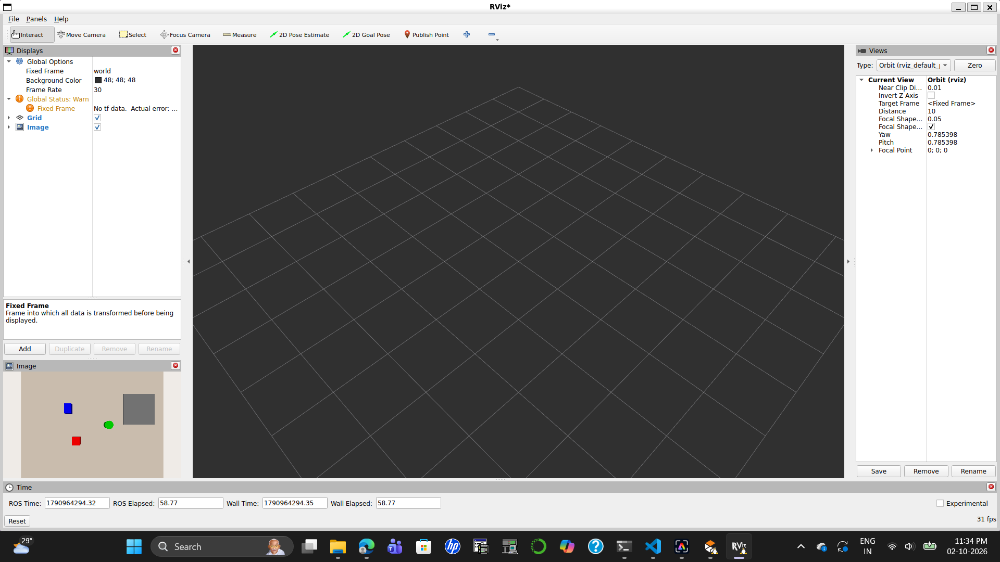
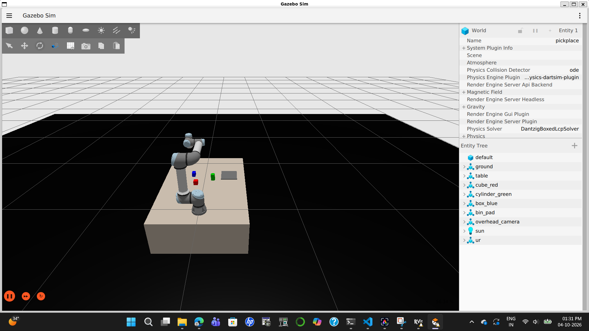

# Vision-Guided Pick-and-Place (ROS 2 + Gazebo + MoveIt 2)

*UR5e performing a pick-and-place motion sequence in Gazebo: above the cube, descend, lift, move to the drop pad, descend, lift, and return to the ready pose. Planned with MoveIt 2 and driven by a Python node using pymoveit2.*

*UR5e planning and moving above the red cube using MoveIt 2 and a Python node.*

**Task:** Pick 3 object types (cube, cylinder, box) from a table and place them in a bin.
**Metrics:** grasp success rate, detection mAP, cycle time, pose error (mm).
**v1 constraint:** top-down grasps only.

